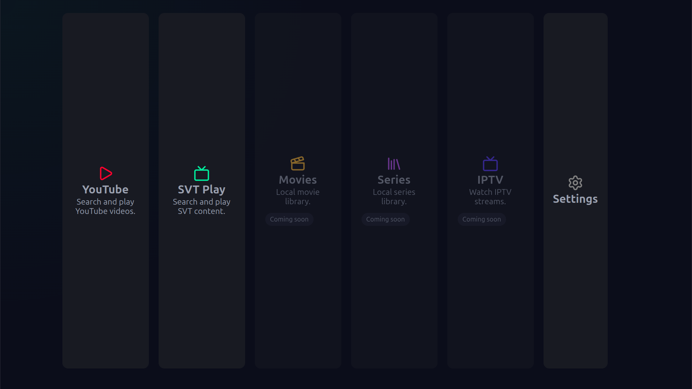

# BeamHub



A self-hosted media platform for projector-based home entertainment systems.

> Developing open source software without a cookie banner.

BeamHub exists as an alternative to modern media platforms overloaded with advertisements, telemetry, account requirements and subscription-driven ecosystems. The goal is to provide a fast, self-hosted media experience that prioritizes user control, simplicity and ownership.

## Features

- YouTube search powered by yt-dlp
- Fullscreen playback through mpv
- React-based TV interface
- Raspberry Pi 5 optimized
- Custom ESP32 air-mouse support
- Self-hosted architecture

## Features to be implemented
- [x] SVT
- [x] YouTube (yt-dlp)
- [ ] Jellyfin
- [ ] Live TV / IPTV
- [ ] Custom remote

## Roadmap

- [ ] IPTV / M3U support
- [ ] Channel browser
- [ ] Local movie library
- [ ] TV-series management
- [ ] Watch progress tracking
- [ ] EPG integration
- [ ] Proxy/VPN support
- [ ] Physical media integrations

## Architecture

```text
React Frontend
       │
       ▼
Express API
       │
       ▼
      mpv
       │
       ▼
Projector / Soundbar
