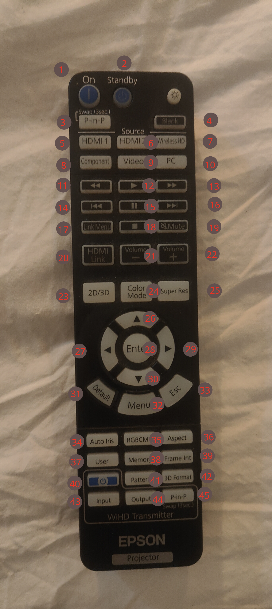
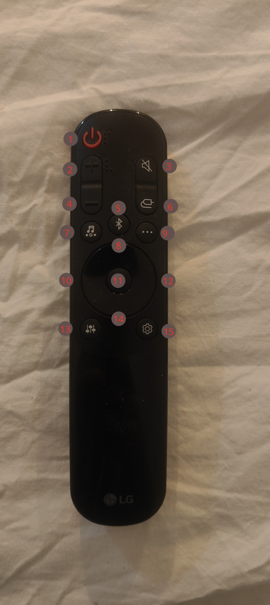

## Epson Remote

| ID | BUTTON       | PROTOCOL | ADDRESS | COMMAND | RAW DATA   | NOTES            |
|----|--------------|----------|--------|---------|------------|------------------|
| 1  | ON           | NEC 2    | 0x5583 | 0x90    | 0x6F905583 |                  |
| 2  | STANDBY      | NEC 2    | 0x5583 | 0x91    | 0x6E915583 |                  |
| 3  | P-in-P       | NEC 2    | 0x5583 | 0x82    | 0x7D825583 |                  |
| 4  | Blank        | NEC 2    | 0x5583 | 0x93    | 0x6C935583 |                  |
| 5  | HDMI 1       | NEC 2    | 0x5583 | 0x73    | 0x8C735583 |                  |
| 6  | HDMI 2       | NEC 2    | 0x5583 | 0x77    | 0x88775583 |                  |
| 7  | Wireless HD  | NEC 2    | 0x5583 | 0x78    | 0x87785583 |                  |
| 8  | Component    | NEC 2    | 0x5583 | 0x71    | 0x8E715583 |                  |
| 9  | Video        | NEC 2    | 0x5583 | 0x70    | 0x8F705583 |                  |
| 10 | PC           | NEC 2    | 0x5583 | 0x9D    | 0x629D5583 |                  |
| 11 | Rewind       | NEC 2    | 0x5583 | 0x5A    | 0xA55A5583 |                  |
| 12 | Play         | NEC 2    | 0x5583 | 0x5E    | 0xA15E5583 |                  |
| 13 | Fast forward | NEC 2    | 0x5583 | 0x5C    | 0xA35C5583 |                  |
| 14 | Previous     | NEC 2    | 0x5583 | 0x5D    | 0xA25D5583 |                  |
| 15 | Pause        | NEC 2    | 0x5583 | 0x5B    | 0xA45B5583 |                  |
| 16 | Next         | NEC 2    | 0x5583 | 0x5F    | 0xA05F5583 |                  |
| 17 | Link Menu    | NEC 2    | 0x5583 | 0x60    | 0x9F605583 |                  |
| 18 | Stop         | NEC 2    | 0x5583 | 0x59    | 0xA6595583 |                  |
| 19 | Mute         | NEC 2    | 0x5583 | 0xAD    | 0x52AD5583 |                  |
| 20 | HDMI Link    | NEC 2    | 0x5583 | 0x56    | 0xA9565583 |                  |
| 21 | Volume -     | NEC 2    | 0x5583 | 0x99    | 0x66995583 |                  |
| 22 | Volume +     | NEC 2    | 0x5583 | 0x98    | 0x67985583 |                  |
| 23 | 2D / 3D      | NEC 2    | 0x5583 | 0x23    | 0xDC235583 |                  |
| 24 | Color Mode   | NEC 2    | 0x5583 | 0x8F    | 0x708F5583 |                  |
| 25 | Super Res    | NEC 2    | 0x5583 | 0xAA    | 0x55AA5583 |                  |
| 26 | D-PAD UP     | NEC 2    | 0x5583 | 0xB0    | 0x4FB05583 |                  |
| 27 | D-PAD LEFT   | NEC 2    | 0x5583 | 0xB3    | 0x4CB35583 |                  |
| 28 | D-PAD ENTER  | NEC 2    | 0x5583 | 0x85    | 0x7A855583 |                  |
| 29 | D-PAD RIGHT  | NEC 2    | 0x5583 | 0xB1    | 0x4EB15583 |                  |
| 30 | D-PAD DOWN   | NEC 2    | 0x5583 | 0xB2    | 0x4DB25583 |                  |
| 31 | Default      | NEC 2    | 0x5583 | 0x39    | 0xC6395583 |                  |
| 32 | Menu         | NEC 2    | 0x5583 | 0x9A    | 0x659A5583 |                  |
| 33 | Esc          | NEC 2    | 0x5583 | 0x84    | 0x7B845583 |                  |
| 34 | Auto Iris    | NEC 2    | 0x5583 | 0x25    | 0xDA255583 |                  |
| 35 | RGBCMY       | NEC 2    | 0x5583 | 0x3D    | 0xC23D5583 |                  |
| 36 | Aspect       | NEC 2    | 0x5583 | 0x8A    | 0x758A5583 |                  |
| 37 | User         | NEC 2    | 0x5583 | 0x9F    | 0x609F5583 |                  |
| 38 | Memory       | NEC 2    | 0x5583 | 0x8B    | 0x748B5583 |                  |
| 39 | Frame Int    | NEC 2    | 0x5583 | 0x83    | 0x7C835583 |                  |
| 40 | WiHD Power   | NEC 2    | 0x381  | 0x40    | 0xBF400381 | WiHD Transmitter |
| 41 | Pattern      | NEC 2    | 0x5583 | 0x96    | 0x69965583 |                  |
| 42 | 3D Format    | NEC 2    | 0x5583 | 0x3B    | 0xC43B5583 |                  |
| 43 | Input        | NEC 2    | 0x381  | 0x41    | 0xBE410381 | WiHD Transmitter |
| 44 | Output       | NEC 2    | 0x381  | 0x42    | 0xBD420381 | WiHD Transmitter |
| 45 | P-in-P       | NEC 2    | 0x381  | 0x43    | 0xBC430381 | WiHD Transmitter |

## LG Soundbar Remote

| ID | BUTTON       | PROTOCOL | ADDRESS | COMMAND | RAW DATA   | NOTES            |
|----|--------------|----------|--------|---------|------------|------------------|
| 1  | ON/OFF       | SAMSUNG  | 0x2C   | 0x1E    | 0xE11E2C2C |                  |
| 2  | Volume+      | SAMSUNG  | 0x2C   | 0x17    | 0xE8172C2C |                  |
| 3  | Mute         | SAMSUNG  | 0x2C   | 0x1F    | 0xE01F2C2C |                  |
| 4  | Volume-      | SAMSUNG  | 0x2C   | 0x16    | 0xE9162C2C |                  |
| 5  | Bluetooth    | SAMSUNG  | 0x2C   | 0x4C    | 0xB34C2C2C |                  |
| 6  | Input        | SAMSUNG  | 0x2C   | 0x8A    | 0x758A2C2C |                  |
| 7  | Sound        | SAMSUNG  | 0x2C   | 0x2F    | 0xD02F2C2C |                  |
| 8  | D-PAD UP     | SAMSUNG  | 0x2C   | 0xA7    | 0x58A72C2C |                  |
| 9  | 3 Dots       | SAMSUNG  | 0x2C   | 0xA3    | 0x5CA32C2C |                  |
| 10 | D-PAD LEFT   | SAMSUNG  | 0x2C   | 0xA8    | 0x57A82C2C |                  |
| 11 | D-PAD CENTER | SAMSUNG  | 0x2C   | 0xAA    | 0x55AA2C2C |                  |
| 12 | D-PAD RIGHT  | SAMSUNG  | 0x2C   | 0xA9    | 0x56A92C2C |                  |
| 13 | Equalizer    | SAMSUNG  | 0x2C   | 0x98    | 0x67982C2C |                  |
| 14 | D-PAD DOWN   | SAMSUNG  | 0x2C   | 0xA6    | 0x59A62C2C |                  |
| 15 | Settings     | SAMSUNG  | 0x2C   | 0xA5    | 0x5AA52C2C |                  |
